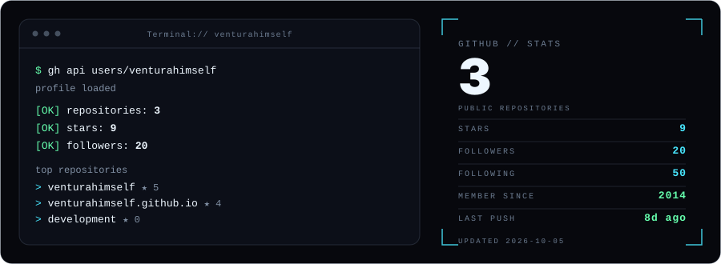

<div align="center">



<br>

# VENTURA HIMSELF

### `Independent mind. Technical curiosity. Continuous evolution.`

<p>
  <a href="https://github.com/venturahimself">
    
  </a>
  <a href="https://venturahimself.github.io">
    
  </a>
  
</p>

<p>
  <i>Exploring ideas, building things, and learning how systems fit together.</i>
</p>

</div>

---

## `01 / ABOUT`

I'm **Ventura Himself** — curious by nature, drawn to technology, digital projects, and the process of turning ideas into something real.

This GitHub profile is my public workspace: a place for experiments, projects, problem-solving, and whatever I discover along the way.

- **Explore** — learn how things work, from the surface down to the details.
- **Build** — turn concepts into practical projects and useful tools.
- **Improve** — iterate, experiment, and keep learning.
- **Share** — make work visible and give ideas room to grow.

> The goal isn't to know everything. It's to keep asking better questions and build better things.

## `02 / CURRENT FOCUS`

<table>
  <tr>
    <td width="50%" valign="top">
      <h3>⌘ Building</h3>
      Developing ideas into practical digital projects, experimenting with approaches, and improving the details that make software feel considered.
    </td>
    <td width="50%" valign="top">
      <h3>◈ Exploring</h3>
      Exploring technology, systems, automation, design, and the connections between them.
    </td>
  </tr>
  <tr>
    <td width="50%" valign="top">
      <h3>⌁ Learning</h3>
      Learning through hands-on work, testing assumptions, and understanding why a solution works—not just whether it works.
    </td>
    <td width="50%" valign="top">
      <h3>↗ Improving</h3>
      Refining workflows, simplifying complexity, and making each iteration more useful than the last.
    </td>
  </tr>
</table>

## `03 / SELECTED WORK`

The repositories below are the best place to explore what I'm working on. Projects evolve over time, so check each repository for its current status, documentation, and setup instructions.

<p align="center">
  <a href="https://github.com/venturahimself?tab=repositories">
    
  </a>
</p>

<!--
When you have chosen the projects you want to feature, replace this comment
with 2–4 real projects and a one-line description for each.

Example:
### [Project name](https://github.com/venturahimself/REPOSITORY)
A short explanation of the problem it solves and what makes it interesting.
-->

## `04 / GITHUB ACTIVITY`

<div align="center">



<br>


<br>


</div>

<sub>Statistics are provided by third-party services and may occasionally be unavailable or delayed.</sub>

## `05 / PRINCIPLES`

```text
 curiosity > assumptions
 clarity   > complexity
 progress  > perfection
 practice  > theory alone
```

I value thoughtful problem-solving, useful work, honest iteration, and the freedom to explore an idea before deciding what it could become.

## `06 / CONNECT`

Have an idea, spotted something interesting, or want to talk about a project?

<p align="center">
  <a href="https://github.com/venturahimself">
    
  </a>
  <a href="https://venturahimself.github.io">
    
  </a>
</p>

---

<div align="center">

<sub><code>VENTURAHIMSELF / KEEP EXPLORING / KEEP BUILDING</code></sub>

<br><br>


</div>
